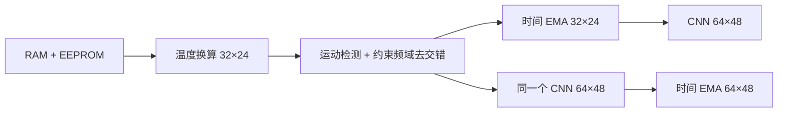

# MLX90640 Thermal Pipeline

MLX90640 原生温度处理：**保留观测的运动自适应去交错 → 运动自适应时间降噪 → 轻量 CNN 二倍重建**。同时提供 CNN 与时间降噪两种顺序的同输入、同权重对照。

[English](README.en.md) · [算法说明](docs/algorithms.md) · [训练复现](docs/training.md) · [树莓派运行](docs/raspberry-pi.md) · [验证范围](docs/validation.md) · [离线说明页](docs/offline/index.html)

## 范围与证据

此仓库整理自已经运行的研究程序，活动去交错版本为 `confirmed_frequency_repair_v3`。它仅修改运动区域内较旧子页的选中像元，最新子页和其余位置的原始浮点数保持逐字节不变。EMA 和 CNN 的结果单独保存为派生估计，不继承去交错层的逐像元观测约束。

原始探测器阵列为 **32×24**；CNN 输出 **64×48** 是重建网格。合成测试误差、静态时间标准差、数值一致性均不能单独证明真实空间分辨率或绝对测温精度。当前 CNN 使用 Lepton 单传感器合成 LR/HR 配对训练，没有真实配准的 MLX90640/高分辨率监督。详细证据和限制见 [验证记录](docs/validation.md)。



## 快速运行

需要 Python 3.10 或更新版本。基础演示只依赖 NumPy 和 OpenCV，不需要传感器、模型权重或训练数据。

```bash
python -m pip install .
mlx90640-pipeline demo --output outputs/demo
```

输出 `synthetic_raw.npz`、`synthetic_profile.npz`、`processed.npz` 和 `processed.png`。默认演示使用明确标注的 **双线性基线，不是训练后的 CNN**；合成 RAM 为测试占位数据，不可用于解释真实 DN 温度换算。打开桌面回放可增加 `--show`。纯图像 2×3 是默认布局，`--labels` 添加说明，`--layout stages` 显示处理阶段。

如果已有依赖，不必安装到环境，可从仓库直接运行：

```bash
PYTHONPATH=src python -m mlx90640_pipeline demo --output outputs/demo
```

Windows PowerShell 使用自己的现有解释器：

```powershell
$env:PYTHONPATH = (Resolve-Path -LiteralPath './src').Path
& $env:MLX90640_PYTHON -B -m mlx90640_pipeline demo --output outputs/demo
```

先把 `MLX90640_PYTHON` 设置为现有 Python 可执行文件。代码不创建虚拟环境，也不自动安装依赖。

## 使用训练模型

PyTorch 训练和推理依赖位于 `train` 可选依赖组；ONNX 推理依赖位于 `onnx` 组；树莓派采集依赖位于 `pi` 组。已有 PyTorch/CUDA 环境应继续复用，不需要为运行演示替换现有堆栈。

```bash
python -m pip install '.[train]'
mlx90640-pipeline demo --output outputs/demo_cnn --checkpoint /path/to/best.pt

python -m pip install '.[onnx]'
mlx90640-pipeline demo --output outputs/demo_onnx --onnx /path/to/model.onnx
```

发布源码不内嵌训练集、私人录像、设备 EEPROM 或预训练权重；已选模型的结构、训练配置、选择记录和 SHA256 保存在 [模型说明](docs/model-card.md)。已有权重可通过明确路径使用，也可以按 [训练文档](docs/training.md) 生成自己的权重。可用 `--model-sha256` 核验指定模型身份。

## 真实录像与设备标定

```bash
# 对相机和场景都静止的区间标定；设备身份随录像保存。
mlx90640-pipeline calibrate captures/static.npz --start 5 --end 17.5 --output profiles/noise.npz

# 在同一设备录像上重算；已有派生数组不会被当成输入。
mlx90640-pipeline replay captures/motion.npz --profile profiles/noise.npz --checkpoint /path/to/best.pt --output outputs/motion_processed.npz --show
```

当前算法只接受 **16 Hz 子页设置、棋盘模式**。噪声配置绑定设备序列号、EEPROM 哈希和分辨率设置，不能将一颗传感器的标定无条件用于另一颗。旧格式录像可通过同目录 `sensor_factory.json` 或 `--factory` 指定工厂信息。输入格式、时间含义和数据保护规则见 [数据格式](docs/data-format.md)。

## 2×3 对照

| 布局 | 左 | 中 | 右 |
|---|---|---|---|
| 上排 | 去交错 D | CNN(D) | EMA(CNN(D)) |
| 下排 | 同一个 D | EMA(D) | CNN(EMA(D)) |

两条顺序共享原生运动权重及重置决定。整帧权重等于 1 时，两条路径都输出当前帧 CNN(D)。各图使用相同色标；显示缩放不进入温度计算。`stages` 布局依次为原始温度、单次频域结果、实际写回掩膜、最终去交错、原生时间滤波、CNN 最终结果。

## 代码结构

```text
src/mlx90640_pipeline/
  core/spatial.py        最新子页十字邻域重建
  core/frequency.py      FFT 频域滤波器
  core/motion.py         噪声标准化、时间有效性、观测保护
  core/repair.py         区域确认与 v3 约束频域写回
  core/temporal.py       局部与全局运动自适应 EMA
  core/guided_ema.py     原生权重到两种网格的映射
  core/postprocess.py    两种处理顺序的共享权重实现
  model.py              16,732 参数 ThermalSRx2
  inference.py          PyTorch / ONNX / 明确标注的插值基线
  calibration.py        静态录像标定
  recording.py          原始数据验证与原子保存
  capture.py            树莓派采集与原始子页审计
  pipeline.py           原生处理与后处理组合
  viewer.py             2×3 显示
  training/             准备、训练、评价、ONNX 导出
configs/                冻结训练配置与受试者划分
tests/                  数值契约、运动旁路、模型与采集适配测试
tools/                  原版本回归与发布文件检查
docs/                   原理、使用、数据、来源、证据和发布说明
```

[来源清单](docs/provenance/source_manifest.json) 记录整理前核心文件的 SHA256 和修改范围。数值内核保持原计算逻辑，路径和后端依赖改为显式参数。新的采集包装、命令行和存储接口分别测试，不能用旧展示程序的现场运行记录替代新入口的现场验收。

## 检查

```bash
python -m unittest discover -s tests -v
python tools/audit_release.py
```

可选训练依赖未安装时，模型测试明确跳过；基础算法测试仍可运行。GitHub Actions 配置分别覆盖基础和 CPU 模型检查。当前本地测试结果与原版本回归结果见 [验证记录](docs/validation.md)。

## 许可与引用

本项目代码和原创说明采用 [MIT](LICENSE)。外部数据、第三方库和专利文献适用各自条款；项目许可不改变其权利范围。数据集不随源码分发，下载入口及引用见 [第三方说明](THIRD_PARTY_NOTICES.md)。频域方法借鉴专利公开描述，数值宽度、部分抑制强度和观测约束循环属于本项目实现，不宣称与厂商闭源二进制等价。

发布步骤见 [发布说明](docs/releasing.md)。
